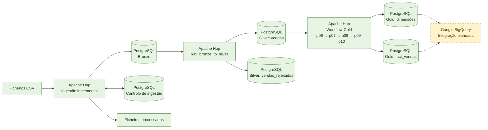

# sales_incremental

Projeto de engenharia de dados para processar ficheiros de vendas com Apache Hop, usando uma arquitetura medalhão híbrida: processamento e armazenamento operacional em PostgreSQL e integração analítica prevista com Google BigQuery.

## Arquitetura



O Apache Hop orquestra a ingestão, transformação e carga. A Gold inclui dimensões e uma tabela de factos.

**Legenda:** verde representa componentes e fluxos existentes; amarelo tracejado representa a integração com BigQuery.


## Camadas de dados

| Camada | Responsabilidade |
|---|---|
| **Bronze** | Registar os dados de origem dos ficheiros de vendas, mantendo o histórico recebido. |
| **Silver** | Normalizar e tipar os dados; encaminhar linhas inválidas para rejeições com a respetiva descrição e código de erro. |
| **Gold** | Disponibilizar dimensões conformadas e a fact table de vendas para análise. |
| **BigQuery** | Destino analítico cloud planeado para consumo e análise. |

As tabelas Silver definidas no projeto são `silver.vendas` e `silver.vendas_rejeitadas`. A Gold é composta por `gold.dim_calendario`, `gold.dim_loja`, `gold.dim_produto`, `gold.dim_vendedor`, `gold.dim_metodo_pagamento` e `gold.fact_vendas`.

## Fluxo de processamento

### Ingestão e Silver

O workflow incremental da Silver prepara as tabelas, identifica ficheiros novos, atualiza o controlo de ingestão, processa os ficheiros e move os ficheiros processados. A pipeline `p05_bronze_to_silver.hpl` lê da Bronze, normaliza os registos e grava dados válidos na Silver ou regista rejeições.

### Gold

O workflow `02_golde_incremental_workflow.hwf` executa as etapas nesta ordem:

1. `p06_preparar_dim_calendario.hpl` — cria e popula o calendário.
2. `p07_preparar_dimensoes_gold.hpl` — prepara as tabelas de dimensão.
3. `p08_preparar_fact_vendas.hpl` — prepara a tabela de factos.
4. `p09_carregar_dimensoes_gold.hpl` — carrega as dimensões a partir da Silver.
5. `p10_carregar_fact_vendas.hpl` — carrega a fact table a partir da Silver.

As cargas Gold usam operações de conflito/upsert para suportar reexecuções. A fact table usa `source_record_key` para identificar linhas de origem, preservando linhas repetidas da origem sem as duplicar numa reexecução.

## Estrutura do projeto

```text
Sales_incremental/
├── metadata/       # Definições locais de conexões do Apache Hop
├── pipeline/       # Pipelines de ingestão, transformação, validação e carga
├── sql/            # Scripts de criação e carga das tabelas
├── workflow/       # Orquestração dos processos Silver e Gold
├── data/           # Ficheiros de entrada, processados e logs locais
├── project-config.json
└── README.md
```

As pipelines exploratórias estão em `pipeline/rascunho/` e não fazem parte do fluxo principal documentado.

## Requisitos

- Apache Hop compatível com a versão usada no projeto (validado com Hop 2.19).
- PostgreSQL acessível a partir do ambiente onde o Hop é executado.
- Uma conexão Hop chamada `SUA CONEXAO`, configurada localmente.
- Para ativar o destino cloud: projeto Google Cloud, dataset BigQuery, credenciais com permissões apropriadas e conexão Hop `SUA CONEXAO CLOUD BIGQUERT` configurada.

## Configuração local

1. Abra ou importe o projeto no Apache Hop e confirme o diretório do projeto (`PROJECT_HOME`).
2. Configure a conexão PostgreSQL `SUA CONEXAO` no ambiente local do Hop.
3. Defina as pastas de entrada e processamento. O projeto usa `PASTA_INPUT` e `PASTA_PROCESSED`, por omissão sob `${PROJECT_HOME}/data`.
4. Coloque os CSV de vendas na pasta de entrada configurada.
5. Execute o workflow de Silver antes do workflow Gold.
6. Para integrar BigQuery, configure a conexão `SUA CONEXAO` localmente e implemente/teste a etapa de publicação da Gold. 

Os valores de conexão e credenciais são específicos de cada ambiente.

## Execução e verificações

Execute primeiro o workflow Silver e confirme que o ficheiro foi processado, que as linhas esperadas estão em `silver.vendas` e que eventuais rejeições estão em `silver.vendas_rejeitadas`. Só depois execute o workflow Gold.


## Calendário

A dimensão calendário é criada pelo script `sql/02_create_gold_dim_calendario.sql`. O seu limite final atual é 31 de dezembro do ano corrente mais dois anos, calculado no momento da execução. Para avançar o intervalo, execute novamente a etapa de preparação do calendário (`p06`), incluída no workflow Gold.

## Controlo de versão e dados sensíveis

O `.gitignore` exclui dados locais, logs, ficheiros JSON e o conteúdo de `metadata/`, que pode conter configurações específicas do ambiente.

## Principais scripts SQL

| Ficheiro | Finalidade |
|---|---|
| `sql/01_create_silver_vendas.sql` | Criar/preparar as tabelas da Silver. |
| `sql/02_create_gold_dim_calendario.sql` | Criar e popular a dimensão calendário. |
| `sql/03_create_gold_dimensions.sql` | Criar as dimensões Gold. |
| `sql/04_create_gold_fact_vendas.sql` | Criar a fact table e os seus índices. |
| `sql/05_load_gold_dimensions.sql` | Carregar as dimensões a partir da Silver. |
| `sql/06_load_gold_fact_vendas.sql` | Carregar os factos a partir da Silver. |
